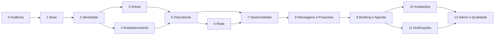

# Roadmap de Desenvolvimento

Desenvolvimento **obrigatoriamente por etapas**. Cada etapa termina com resumo, testes e aguarda autorização explícita antes da próxima.

---

## Visão geral

Dependências fortes: 0→1→2; 3 e 4 após 2; 5 após 3–4; 7 após 5 (e idealmente 3–4); 8 após 7; 9 após 8; 10 e 11 após 9; 12 ao final.

---

## Etapas

### Etapa 0 — Auditoria do repositório

| Campo | Conteúdo |
|-------|----------|
| Objetivo | Comprender stack, arquitetura e reaproveitamento; documentar |
| Escopo | Leitura + docs; sem features de domínio |
| Critério | Docs criados; diagnóstico apresentado; autorização para Etapa 1 |
| Status | **Concluída** |

### Etapa 1 — Preparação da base

| Campo | Conteúdo |
|-------|----------|
| Objetivo | App executável localmente sem quebrar o skeleton |
| Escopo | Runtime Docker, `.env`, migrations, regras Cursor, smoke tests |
| Depende de | Etapa 0 + runtime (**Docker** confirmado) |
| Critério | `GET /` e testes smoke OK; docs de setup; regras em `.cursor/rules/` |
| Status | **Concluída** — app em http://localhost:8080; 2 testes PHPUnit OK |

### Etapa 2 — Identidade, autenticação e perfis

| Campo | Conteúdo |
|-------|----------|
| Objetivo | Conta segura + perfil básico + tipos Artista/Estabelecimento |
| Escopo | Cadastro, login, logout, reset senha, foto, localização, desativação; autorização |
| Depende de | Etapa 1 |
| Critério | Usuário gerencia só seus dados; admin separado |
| Status | **Concluída** — Breeze + perfis artista/venue + desativação soft; 30 testes OK |

### Etapa 3 — Perfil profissional do artista

| Campo | Conteúdo |
|-------|----------|
| Objetivo | Página pública profissional do artista |
| Escopo | Campos de portfólio, mídia validada, gêneros, cachê, disponibilidade; edição só do dono |
| Depende de | Etapa 2 |
| Critério | Página pública + edição autorizada + perfil progressivo |
| Status | **Concluída** — `/artistas/{slug}` + edição progressiva + mídia/experiências |

### Etapa 4 — Perfil do estabelecimento

| Campo | Conteúdo |
|-------|----------|
| Objetivo | Página pública do espaço |
| Escopo | Dados do venue, mídia, estrutura, orçamento, autorização de gestores |
| Depende de | Etapa 2 |
| Critério | Página pública + gestão autorizada |
| Status | **Concluída** — `/estabelecimentos/{slug}` + gestores + mídia + oportunidades base |

### Etapa 5 — Descoberta e busca

| Campo | Conteúdo |
|-------|----------|
| Objetivo | Encontrar artistas, estabelecimentos e oportunidades |
| Escopo | Filtros, paginação backend, índices; geo por cidade/região |
| Depende de | Etapas 3 e 4 (e modelo mínimo de oportunidades se já existir stub) |
| Critério | Filtros funcionais sem carregar tudo |
| Status | **Concluída** — `/artistas`, `/estabelecimentos`, `/oportunidades` com filtros + paginação |

### Etapa 6 — Rede profissional

| Campo | Conteúdo |
|-------|----------|
| Objetivo | Seguir/favoritar com contagens reais |
| Escopo | follows, favorites, unicidade no DB; feed simples opcional |
| Depende de | Etapa 5 (perfis descobertos) |
| Critério | Listas e contagens corretas; sem rede social genérica |
| Status | **Concluída** — seguir/favoritar + `/rede` com feed de oportunidades |

### Etapa 7 — Oportunidades e candidaturas

| Campo | Conteúdo |
|-------|----------|
| Objetivo | Núcleo do marketplace |
| Escopo | CRUD oportunidade, candidaturas, status, autorização |
| Depende de | Etapas 3–5 |
| Critério | Publicar → candidatar → gerenciar candidatos |
| Status | **Concluída** — candidaturas + gestão de status + `/candidaturas` |

### Etapa 8 — Mensagens e propostas

| Campo | Conteúdo |
|-------|----------|
| Objetivo | Negociação estruturada |
| Escopo | Conversas, mensagens paginadas, propostas versionadas/status |
| Depende de | Etapa 7 |
| Critério | Só partes autorizadas negociam; regras no backend |
| Status | **Concluída** — `/negociacoes` + mensagens paginadas + propostas versionadas |

### Etapa 9 — Agenda, booking e experiência verificada

| Campo | Conteúdo |
|-------|----------|
| Objetivo | Contratação e histórico verificável |
| Escopo | Transições de status, conflito de agenda, conclusão explícita |
| Depende de | Etapa 8 |
| Critério | Booking confirmado → show concluído → experiência rastreável |
| Status | **Concluída** — `/agenda` + conflito + conclusão dual + experiência verificada |

### Etapa 10 — Avaliações e reputação

| Campo | Conteúdo |
|-------|----------|
| Objetivo | Reputação baseada em bookings elegíveis |
| Escopo | Uma avaliação por participante/booking; moderação admin |
| Depende de | Etapa 9 |
| Critério | Sem avaliações fabricadas |
| Status | **Concluída** — reviews 1–5 pós-booking + denúncia + ocultação admin |

### Etapa 11 — Notificações

| Campo | Conteúdo |
|-------|----------|
| Objetivo | Alertas internos dos eventos críticos |
| Escopo | Persistência em DB; idempotência; e-mail/push depois |
| Depende de | Etapas 7–10 (eventos) |
| Critério | Destinatários corretos; sem duplicatas abusivas |
| Status | **Concluída** — `/notificacoes` + disparos nos eventos críticos + idempotência |

### Etapa 12 — Painel administrativo e qualidade

| Campo | Conteúdo |
|-------|----------|
| Objetivo | Moderação + endurecimento do MVP |
| Escopo | Admin, auditoria, testes, índices, uploads, a11y, docs de backup |
| Depende de | Fluxo principal estável |
| Critério | Mecanismos mínimos de admin, segurança e manutenção |
| Status | **Concluída** — `/admin` + suspensão + denúncias + audit log + `docs/BACKUP.md` |

### Etapa 13 — Base da API `/api/v1/`

| Campo | Conteúdo |
|-------|----------|
| Objetivo | Fundação JSON para clientes sem sessão de navegador |
| Escopo | Sanctum (tokens), auth login/me/logout, descoberta pública, notificações autenticadas |
| Depende de | Etapas 0–12 (regras já estáveis na web) |
| Critério | Mesmas policies/regras; erros JSON; sem Flutter |
| Status | **Concluída** — Sanctum + endpoints base + testes Feature |

### Etapa 14 — API marketplace (candidaturas, agenda, rede)

| Campo | Conteúdo |
|-------|----------|
| Objetivo | Expor o núcleo do marketplace via `/api/v1` |
| Escopo | Candidaturas, bookings (listar/concluir/cancelar), follow/favorite |
| Depende de | Etapa 13 |
| Critério | Mesmas Policies/notificações da web; testes Feature |
| Status | **Concluída** — endpoints autenticados + `docs/API.md` |

### Etapa 15 — API negociações (mensagens e propostas)

| Campo | Conteúdo |
|-------|----------|
| Objetivo | Negociação estruturada via API |
| Escopo | Conversas, mensagens paginadas, propostas versionadas/aceite→booking |
| Depende de | Etapa 14 |
| Critério | Mesmas Policies da web; só participantes; testes Feature |
| Status | **Concluída** — `/conversations` + propostas + booking |

### Etapa 16 — Convites de integrantes de banda

| Campo | Conteúdo |
|-------|----------|
| Objetivo | Completar D4b: banda com membros sem compartilhar senha |
| Escopo | Convite por e-mail, aceite/recusa, cancelamento, remoção, notificações |
| Depende de | Etapas 3 e 11 |
| Critério | Só owner/admin convida; convidado aceita; owner irremovível |
| Status | **Concluída** — `/convites` + edição do perfil artista |

### Etapa 17 — E-mail opcional das notificações

| Campo | Conteúdo |
|-------|----------|
| Objetivo | Espelhar alertas in-app por e-mail quando o usuário optar |
| Escopo | `AppNotificationMail` + preferência `notify_email`; sem push |
| Depende de | Etapa 11 |
| Critério | Opt-out respeitado; idempotência sem reenvio; `MAIL_MAILER=log` local |
| Status | **Concluída** — envio no `InAppNotifier` |

### Etapa 18 — Admin API

| Campo | Conteúdo |
|-------|----------|
| Objetivo | Moderação via `/api/v1/admin` com as mesmas regras do painel web |
| Escopo | Dashboard, usuários (suspender/reativar), denúncias, unhide |
| Depende de | Etapas 12 e 13 |
| Critério | Só `is_platform_admin`; auditoria; 403 para demais |
| Status | **Concluída** — rotas Sanctum + `platform.admin` |

### Etapa 19 — Mutações de perfil via API

| Campo | Conteúdo |
|-------|----------|
| Objetivo | Conta e perfis profissionais editáveis por API |
| Escopo | `PATCH /auth/me`, `/me/artists`, `/me/venues` (CRUD mínimo) |
| Depende de | Etapas 2–4 e 13 |
| Critério | Mesmos Form Requests/Policies da web; estranho recebe 403 |
| Status | **Concluída** — conta + artista + venue |

---

## Funcionalidades previstas (checklist consolidado)

- [x] Ambiente local estável (Etapa 1)
- [x] Auth completa (Etapa 2)
- [x] Perfil artista (Etapa 3)
- [x] Perfil estabelecimento (Etapa 4)
- [x] Busca/filtros (Etapa 5)
- [x] Seguir/favoritar (Etapa 6)
- [x] Oportunidades + candidaturas (Etapa 7)
- [x] Mensagens + propostas (Etapa 8)
- [x] Booking + agenda + conclusão (Etapa 9)
- [x] Avaliações (Etapa 10)
- [x] Notificações internas (Etapa 11)
- [x] Admin + qualidade (Etapa 12)
- [x] Base `/api/v1/` preparada (Etapa 13)
- [x] API marketplace candidaturas/agenda/rede (Etapa 14)
- [x] API negociações mensagens/propostas (Etapa 15)
- [x] Convites de banda (Etapa 16)
- [x] E-mail opcional de notificações (Etapa 17)
- [x] Admin API (Etapa 18)
- [x] Mutações de perfil via API (Etapa 19)

---

## Critérios gerais de conclusão de etapa

Uma etapa só fecha quando:

1. Código implementado com comportamento real (não só UI)
2. Regras documentadas em `BUSINESS_RULES.md` quando afetadas
3. Migrations versionadas criadas
4. Validação e autorização no backend
5. Testes pertinentes executados (ou limitação explícita)
6. App continua executando localmente
7. Skeleton/preexistências relevantes intactas
8. Documentação atualizada
9. Resumo entregue e autorização para a próxima

---

## Próximo passo imediato

**MVP web + API completa (marketplace, admin, perfis) + convites + e-mail opcional.** Push ou convites via API exigem nova autorização.

Comandos úteis: `docs/LOCAL_SETUP.md`. Backup: `docs/BACKUP.md`. API: `docs/API.md`.

- Auth web: http://localhost:8080/register · `/login`
- Admin web / API: `/admin` · `/api/v1/admin`
- Meus perfis API: `/api/v1/me/artists` · `/api/v1/me/venues`
- E-mail local: `MAIL_MAILER=log` → `storage/logs`
